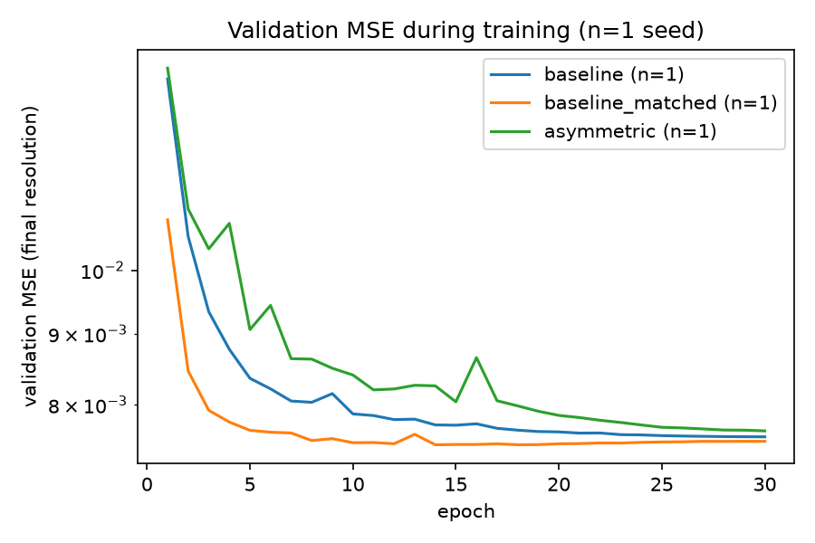

# Asymmetric Auto-Encoder Bottlenecks for Self-Supervised Latent Representation Learning

[](https://asymmetricautoencoder-sinyyamrqrutbizqegvdlp.streamlit.app/)
[](LICENSE)

> ### Live demo: **<https://asymmetricautoencoder-sinyyamrqrutbizqegvdlp.streamlit.app/>**
> Explore the three trained models on CIFAR-10 validation images, with the saved results, noise
> robustness and latent-space tools. It runs on CPU; the first visit to a live tab downloads about
> 24 MB of model files (see [How the demo gets its files](#how-the-demo-gets-its-files)).

A controlled study of whether an **asymmetric autoencoder** (heavy nonlinear encoder, tight latent
bottleneck, lightweight multiscale decoder) learns more compact, useful and noise-robust
representations than a conventional symmetric convolutional autoencoder under matched training
conditions.

## Headline finding (read this first)

**All results come from one training run per model (seed 0).** No variability across seeds was
measured, so nothing here is statistically established, and no significance claim is made.

- The asymmetric autoencoder **did not demonstrate a reconstruction advantage**: its test MSE was
  1.1% higher than the baseline's and 2.3% higher than the parameter-matched baseline's, and its SSIM
  was lower.
- It needs about **5.4x the compute** of the parameter-matched baseline for that result.
- A smaller PSNR drop under input noise is only **directionally supported** (H3), not established.
- The compact-latent hypothesis (H2) was **not fully tested**: no latent-dimension sweep was run.
- Linear-probe accuracy was the same for all trained latents (H4), and no model collapsed (H5).

Full write-up: **[`reports/final_report.md`](reports/final_report.md)**.

## Research question and hypotheses

> Can an asymmetric autoencoder with a constrained nonlinear encoder and lightweight multiscale
> decoder learn more compact, useful and noise-robust latent representations than a conventional
> symmetric autoencoder under comparable training conditions?

This was posed as a hypothesis that the experiments could falsify, not as an established result.
Reconstruction loss alone is a weak measure of representation quality, since a strong decoder can
compensate for an uninformative code.

| ID | Hypothesis | Verdict (single seed) |
|---|---|---|
| H1 | Reconstruction is no worse at equal latent size | Not supported by this evidence; not statistically rejected |
| H2 | A smaller latent suffices at equal quality | **Not fully tested** (no latent-dimension sweep) |
| H3 | Slower degradation under input noise | Directionally supported, **not established** |
| H4 | Better linear-probe accuracy | Not supported |
| H5 | Avoids latent collapse (higher effective rank) | No asymmetric advantage; no collapse in any model |

## Models

All models use a 64-dimensional latent and take 3x32x32 images with pixels in [0, 1].

| Model | Description | Parameters | MACs / image |
|---|---|---|---|
| `baseline` | Symmetric convolutional autoencoder (32/64/128 channels), plain MSE | 450,627 | 5.4 M |
| `baseline_matched` | Same design widened (104/208/416) to match the asymmetric model's parameter count | 2,812,227 | 52.1 M |
| `asymmetric` | Residual encoder (2.77 M params), 64-d bottleneck, light decoder (49.7 k params) with bilinear upsampling and auxiliary heads at 8x8, 16x16 and 32x32, trained with a multiscale MSE | 2,823,625 | 279.9 M |

The asymmetric model's multiscale loss is `sum_s w_s * MSE(x_hat_s, area_average(x, size_s))` with
weights (0.25, 0.5, 1.0). Parameters are matched; **compute is not**. Architecture diagram and
details: [final report, Section 5](reports/final_report.md).

## Dataset and methodology

- **Data:** CIFAR-10 (3x32x32). The 50,000 training images are split deterministically into
  **45,000 train / 5,000 validation** (`split_seed` 0); the official 10,000 test images were evaluated
  **once**, after everything else was frozen. Training is self-supervised (labels are used only to
  fit and score linear probes).
- **Training protocol (identical for every model):** Adam, learning rate 1e-3, cosine annealing over
  30 epochs, batch size 128, latent size 64, seed 0, on Apple M2 (MPS). The best checkpoint is chosen
  by validation MSE.
- **Metrics:** MSE, MAE, PSNR and SSIM on [0, 1] images (data range 1.0). They measure
  reconstruction fidelity, not semantic quality.
- **Robustness (protocol N1):** models trained on clean images receive Gaussian or salt-and-pepper
  corrupted inputs and are scored against the **clean** image (validation split, one noise draw).
  No model was trained to denoise.
- **Latent analysis (inference only):** PCA, effective rank, post-hoc truncation and a linear probe
  fitted on training latents and scored on validation latents.

## Results (single seed)

Test split, evaluated once (validation figures are in the report):

| Model | Params | MACs/img | Test MSE | Test PSNR (dB) | Test SSIM |
|---|---|---|---|---|---|
| baseline | 450,627 | 5.4 M | 0.007601 | 21.81 | 0.6496 |
| baseline_matched | 2,812,227 | 52.1 M | 0.007510 | 21.87 | 0.6503 |
| asymmetric | 2,823,625 | 279.9 M | 0.007683 | 21.76 | 0.6318 |



**Efficiency.** Same parameter count as the matched baseline but 5.4x the MACs and 1.6-6.0x its
latency (Apple M2; latency depends on device and batch size). Parameter count is a poor proxy for
cost here.

**Noise robustness (validation, PSNR in dB).**

| Model | Clean | Drop at Gaussian σ=0.3 | Drop at salt-and-pepper p=0.1 |
|---|---|---|---|
| baseline | 21.81 | 2.25 | 1.60 |
| baseline_matched | 21.86 | 2.37 | 1.78 |
| asymmetric | 21.75 | 1.75 | 1.40 |

The asymmetric model degrades more slowly, but it starts lower on clean images, a model that
discards more detail has less to lose, and the evidence is one training seed. This is directional
only.

**Latent representation (validation).**

| Representation | Linear-probe accuracy (chance 10%) | Effective rank |
|---|---|---|
| raw pixels (3072-d) | 41.2% | - |
| raw pixels, PCA-64 | 38.0% | - |
| baseline latent | 37.9% | 29.3 |
| baseline_matched latent | 37.5% | 37.2 |
| asymmetric latent | 37.9% | 31.3 |

All three trained latents give the same probe accuracy within error, and none beats a plain PCA-64
of the pixels. Post-hoc truncation (decoding from the first k principal components of the latent)
loses more for the asymmetric model than for the baselines, the opposite of what a compactness
advantage would predict. This is a proxy, not a substitute for training at other latent sizes.

More tables and figures (including salt-and-pepper results, truncation curves and probe controls)
are in [`reports/final_report.md`](reports/final_report.md) and [`reports/figures/`](reports/figures/).

## Limitations and negative findings

1. **Single seed.** One training run per model; no means, standard deviations or significance tests.
   Differences of about 1-2% in MSE or 0.4-0.5 dB in noisy PSNR are not interpretable.
2. **Reduced plan.** Three of nine planned runs were completed (seed 0 of each model). The other
   six runs were lost to a Colab runtime reset and could not be rerun because of hardware limits; no
   Colab-trained result is used anywhere.
3. **Not run:** latent-dimension sweep (so H2 is untested), component ablations, denoising training
   (protocol N2), t-SNE/UMAP.
4. **Hardware-specific measurements** on Apple M2/MPS only; no CUDA validation.
5. **One dataset, one resolution and one latent size** (CIFAR-10, 32x32, d = 64).
6. **Parameter-matched, not compute-matched, baseline**; the asymmetric model may also be under-trained
   at 30 epochs (it was still improving).
7. **Proxy measures:** reconstruction metrics, effective rank, a linear probe and post-hoc truncation
   do not establish general semantic quality.

## Completed work and future work

**Completed:** reproducible pipeline and 196 automated tests; three implemented models; one 30-epoch
run per model (seed 0); one final test evaluation; efficiency, noise-robustness and latent analyses;
the final report; and the interactive demo with its verified artifact downloader.

**Future work (not done):** at least three seeds per model; a latent-dimension sweep for both
architectures; a FLOP-matched baseline and longer schedules; denoising training and component
ablations; non-linear probes and other datasets; CUDA validation and continuous integration.

## Installation

Requires Python >= 3.10 (developed on 3.11).

```bash
git clone https://github.com/aman-18-choudhary/Asymmetric_Auto_Encoder.git
cd Asymmetric_Auto_Encoder
python3.11 -m venv .venv
source .venv/bin/activate
pip install -e ".[dev]"
pytest && ruff check .
```

## Data

Datasets are downloaded on demand into `data/` (git-ignored): MNIST (~11 MB, debugging) and CIFAR-10
(~163 MB, primary).

```bash
python scripts/download_data.py --name mnist
python scripts/download_data.py --name cifar10
```

Images are scaled to [0, 1] with no mean/std normalisation; MNIST is resized to 32x32. The split
depends only on `data.split_seed` (default 0), so all models share it, and labels are never used for
training.

## Training and evaluation

One script and one `Trainer` serve every model; the model is chosen by `model.type` in the config.

```bash
python scripts/train.py --config configs/mnist_debug.yaml                  # fast debug (baseline)
python scripts/train.py --config configs/baseline.yaml --seed 0
python scripts/train.py --config configs/baseline_matched.yaml --seed 0
python scripts/train.py --config configs/asymmetric.yaml --seed 0
python scripts/train.py --config configs/asymmetric.yaml --resume          # continue an interrupted run
```

Each run writes `config.yaml`, `environment.json`, `history.json`, `summary.json` and checkpoints to
`experiments/results/<experiment>_seed<seed>/`. Resume restores model, optimizer, scheduler, history
and RNG state and reproduces an uninterrupted run exactly on the same device. Evaluation, robustness
and latent-analysis commands are listed in
[final report, Section 12](reports/final_report.md).

**Warning:** the seed-0 result files (configs, histories, summaries, evaluation JSON, logs; not
checkpoints) are tracked in Git, so retraining with the default run directories **overwrites them in
place**, and re-runs are not bit-identical to the committed numbers. Back up `experiments/results/`
first, or write to a separate directory as described in the report.

## Interactive demo

**Live:** <https://asymmetricautoencoder-sinyyamrqrutbizqegvdlp.streamlit.app/>. The app is read-only:
it never trains, never writes to `experiments/results/` or `reports/figures/`, and never loads the
official test split (validation images come from the five training batches only). All results shown
come from one training run per model.

Tabs: **Results** (saved metrics, efficiency, robustness and latent analysis; saved test numbers are
labelled as the one-time final evaluation), **Reconstruct** (validation samples through all three
models, with the asymmetric model's multiscale outputs), **Robustness (N1)** (evaluation-only input
corruption, scored against the clean image) and **Latent** (post-hoc PCA truncation, a 2-D projection
and interpolation: exploratory visualisations, not evidence of semantic structure). Live numbers are
computed on CPU and can differ slightly from the saved Apple-MPS results. A walkthrough for a
presentation is in [`docs/faculty_demo_guide.md`](docs/faculty_demo_guide.md).

### Run the demo locally

```bash
pip install -e ".[demo]"                    # adds streamlit and pandas
scripts/run_demo.sh                         # localhost only, usage statistics off
```

With no local checkpoints or demo assets, the first live tab downloads them (below). If you have
trained the models yourself you can instead build the assets once, offline and inference-only:
`python scripts/build_demo_assets.py` (it needs the CIFAR-10 *training* batches in
`data/cifar-10-batches-py/`, never opens `test_batch`, and writes only to `demo/assets/`).

**Privacy.** `.streamlit/config.toml` disables Streamlit's anonymous usage statistics, and
`scripts/run_demo.sh` binds the server to `localhost`. A plain `streamlit run demo/app.py` does not
restrict the address; pass `--server.address localhost --browser.gatherUsageStats false` if you
launch it that way.

### How the demo gets its files

The checkpoints and generated demo assets are git-ignored. The hosted app fetches five files (about
24 MB) on first use from the public GitHub release
[`demo-artifacts-v1`](https://github.com/aman-18-choudhary/Asymmetric_Auto_Encoder/releases/tag/demo-artifacts-v1):
the three seed-0 `best.pt` checkpoints, `val_samples.npz` (300 CIFAR-10 *training-split* images) and
`pca_bases.pt`.

- Each file is listed with its exact **size and SHA-256** in [`demo/artifacts.json`](demo/artifacts.json).
- Downloads use **HTTPS only**; redirects are followed only to `github.com` and
  `release-assets.githubusercontent.com`; files go only to a fixed allow-list of destinations; no
  credentials are used.
- A download is moved into place only after its size and hash match; otherwise it is deleted and the
  tab explains the problem. **Existing local files are never overwritten.**
- If the release is unreachable, the Results tab still works and the other tabs retry about once a
  minute.
- The release publishes the three trained checkpoints and a 300-image sample, so they are public.
  To publish new versions, upload to a new release tag and update `demo/artifacts.json`.

## Repository structure

```
configs/                      experiment configs (baseline, baseline_matched, asymmetric, mnist_debug)
src/asymmetric_autoencoder/   models, training, evaluation, data, demo support and artifact downloader
scripts/                      train / evaluate / robustness / latent analysis / aggregate / demo launchers
tests/                        196 automated tests
demo/                         Streamlit app (app.py) and artifact manifest (artifacts.json)
experiments/results/          saved seed-0 metrics, histories and aggregated tables (checkpoints not tracked)
reports/                      final_report.md and reports/figures/
docs/                         phase reports, faculty demo guide, cloud-transfer notes (historical)
requirements.txt              runtime dependencies for the hosted demo
```

## Documentation

- Research report: [`reports/final_report.md`](reports/final_report.md)
- Faculty demonstration guide: [`docs/faculty_demo_guide.md`](docs/faculty_demo_guide.md)
- Per-phase decisions, commands and verification: [`docs/phase_reports/`](docs/phase_reports/)

## Reproducibility

Seeds are set for Python, NumPy and PyTorch; the split is deterministic; each run stores its exact
configuration and library versions (`environment.json`). Exact reproduction holds on the same
device; MPS and CPU differ slightly (about 0.7% in validation MSE in a short pilot) and MPS/CUDA
kernels are not guaranteed deterministic. All training and measurements used one Apple M2 laptop
(8 GB) on Python 3.11 and PyTorch 2.14; the hardware limit is why the plan was reduced to seed 0.

## Development

```bash
pytest                                   # 196 tests
ruff check .                             # lint
ruff format --check src scripts tests demo
```

Git workflow: `main` (stable) <- `develop` (integration) <- `feature/*`; Conventional Commits.
Datasets and checkpoints are never committed.

## License

MIT, see [`LICENSE`](LICENSE).
