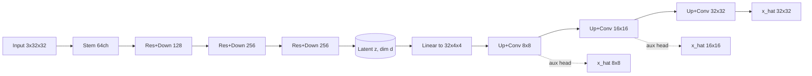

# Phase 0: Research Blueprint

Status: DRAFT for review. Nothing committed or pushed. No model code written.

## A. Phase Summary
Audit the repository and environment, formalize the research design, and produce a phase roadmap. No implementation.

## B. Objectives
Repository audit; research question and hypotheses; architecture spec; dataset and experiment design; repo structure; roadmap; GitHub workflow; risks.

## C. Work Completed
- Audited the local folder and the GitHub repo (verified).
- Audited the Python/PyTorch environment (verified).
- Wrote the blueprint below.

### C1. Repository audit (verified)
| Item | Finding |
|---|---|
| Local folder `~/Projects/Deep_Learning_project` | Empty, not a Git repo (no `.git`) |
| GitHub `aman-18-choudhary/Asymmetric_Auto_Encoder` | Public, exists, completely empty (no commits/branches) |
| Machine | Apple M2, 8 GB RAM, macOS, no CUDA |
| Python available | 3.13.5 (default, Homebrew), 3.11.14 (Homebrew + python.org), 3.10.19 |
| PyTorch | Not installed |
| `git` | Installed. `gh` CLI not installed |

Assumptions (unverified): push rights and credentials configured; MPS backend works for our ops.
Nothing exists to preserve; the first commit becomes the initial history.

### C2. Python version decision
Earlier I flagged Python 3.13 as a risk. Checking PyPI shows current torch (2.14.1) declares support for 3.10–3.14, so that risk was overstated.
- Python 3.11 is already installed, is supported by torch/torchvision/scikit-learn/umap, and is the most widely tested version.
- Python 3.12 would also work, but installing it adds nothing the project needs.
- **Recommendation: use the existing Python 3.11 in a project venv; `brew install python@3.12` is NOT required.** pyproject will declare `requires-python >=3.10`. This is a recommendation, pending your approval; no environment has been changed.

### C3. Research problem
Reconstruction loss is a weak proxy for representation quality, and a strong decoder can compensate for a weak latent code. We test whether constraining the decoder and shaping the bottleneck changes what the latent contains.

### C4. Main question
Does an asymmetric AE (heavy nonlinear encoder, tight bottleneck, lightweight multiscale decoder) learn more compact, useful, noise-robust latents than a symmetric conv AE under matched training conditions?

### C5. Hypotheses
| ID | Hypothesis | Measured by | Falsified if |
|---|---|---|---|
| H1 | At equal latent size, asymmetric reconstructs no worse (within tolerance) | Test MSE/PSNR/SSIM, 3 seeds | Worse by more than ~1 std |
| H2 | At equal reconstruction quality, asymmetric needs smaller latent | Latent-dim vs PSNR curves | Curves overlap or baseline wins |
| H3 | Asymmetric degrades more slowly under input noise | PSNR vs noise level, clean target | Equal or steeper degradation |
| H4 | Asymmetric latents give better linear-probe accuracy (labels for evaluation only) | Frozen latent -> logistic regression | Equal or lower accuracy |
| H5 | Asymmetric avoids latent collapse | Effective rank / participation ratio | Lower effective rank |

Only H4 supports semantic claims. PCA/t-SNE are illustrative only.

### C6. Contribution and limitations
A controlled empirical study, not a SOTA claim. Limits: small datasets, few seeds (preliminary statistics), 32x32 images, linear probe is one proxy.

### C7. Architecture (CIFAR-10, 3x32x32, latent d configurable, default 64)
Terminology: "recursive" = same weights applied k times (shared-weight refinement). Distinct from recurrent processing and plain stacked layers. Off by default; ablation only (k = 0 or 2).

**Model A (baseline):** Conv 3->32 s2 (32x16x16) -> Conv 32->64 s2 (64x8x8) -> Conv 64->128 s2 (128x4x4) -> Flatten -> Linear 2048->d -> Linear d->2048 -> 3x ConvTranspose (128->64->32->3) -> Sigmoid. Plain MSE.

**Model B (asymmetric):** Stem Conv 3->64 -> [ResBlock + stride-2 conv] 64->128 (16x16), 128->256 (8x8), 256->256 (4x4) -> optional shared refinement x k -> Flatten -> Linear 4096->d (+optional LayerNorm) -> Linear d->32x4x4 -> [Upsample x2 + Conv] 32ch @8x8 (aux head 3x8x8), 16ch @16x16 (aux head 3x16x16), 16ch @32x32 (final head 3x32x32).

**Loss:** L = l3*MSE(x32, x) + l2*MSE(x16, avgpool(x)) + l1*MSE(x8, avgpool^2(x)); default l = (1.0, 0.5, 0.25); targets built by area/average pooling. l2=l1=0 gives the single-scale ablation.

**Fairness:** report params and approximate FLOPs for all models; include a parameter-matched (widened) baseline so capacity alone cannot explain any win.

### C8. Dataset and experiment design
- Debug: MNIST. Primary: CIFAR-10. Optional: Fashion-MNIST.
- Protocol (both models): Adam, lr 1e-3 cosine, batch 128, 30 epochs (3 for debug), 45k/5k train/val split with fixed seed, official 10k test set used only for final reporting, seeds {0,1,2}.
- Metrics: MSE, MAE, PSNR (MAX=1.0), SSIM (data_range=1.0), params, FLOPs, train time/epoch, inference latency, latent effective rank, linear probe.
- Noise N1: train clean, test noisy, score vs clean. Gaussian sigma {0.05,0.1,0.2,0.3}; salt-and-pepper p {0.02,0.05,0.1}.
- Noise N2: denoising training (noisy input, clean target) for both models; reported separately, never mixed with N1.

| # | Experiment | Priority |
|---|---|---|
| 1 | Baseline reconstruction | Essential |
| 2 | Asymmetric reconstruction | Essential |
| 3 | Latent dim ablation d in {8,16,32,64,128} | Essential |
| 4 | Noise robustness (N1; N2 secondary) | Essential |
| 5 | Latent analysis: effective rank, linear probe (essential); PCA/t-SNE (illustrative) | Essential/Optional |
| 6 | Efficiency table | Essential |
| 7 | Component ablations (single vs multiscale, refine k, decoder width) | Optional |
| 8 | Denoising AE / VAE baseline | Optional |

## D. Architecture and Technical Decisions
Upsample+conv instead of transposed conv in the proposed decoder (avoids checkerboard artifacts, makes the decoder change explicit). Parameter-matched baseline for fairness. Recursion kept as an ablation, not a headline. Python 3.11 venv (see C2).

## E. Files Added or Modified
- `docs/phase_reports/phase_00_research_blueprint.md` (this file; uncommitted, untracked: folder is not yet a Git repo).

## F. Commands Executed
`ls`, `git status` (not a repo), `python3 --version`, `which -a python3 python3.11 python3.12 brew`, `brew list --versions`, GitHub REST API read of repo metadata/contents, PyPI metadata read for torch.

## G. Verification Results
Only environment/repo inspection. No tests exist or were run.

## H. Experimental Results
None. No experiments have been run.

## I. GitHub Activity
None. No commits, branches, or pushes. Remote repo verified empty.

## J. Issues Encountered
My earlier claim that Python 3.13 might lack torch wheels was not supported by PyPI metadata; corrected in C2.

## K. Outstanding Issues
- Confirm push credentials (SSH/HTTPS) work.
- Decide whether to install `gh`.
- Because the local folder is not a Git repo, Phase 1 must either `git init` + add the remote, or clone the empty remote. Needs your authorization.
- MPS compatibility untested.

## L. Acceptance Criteria
| Criterion | Status |
|---|---|
| Repository inspected | PASS |
| Research question, hypotheses, success criteria defined | PASS |
| Architecture specified | PASS (spec only, unimplemented) |
| Dataset/experiment plan defined | PASS |
| Repo structure proposed | PASS |
| Phase roadmap | PASS (see phases below) |
| User approval of blueprint | NOT YET TESTED (pending review) |

## M. Next Phase: Phase 1 Project Foundation (not started)
Branch `feature/phase-1-foundation` off `develop` (after initial `main` commit and `develop`). Package skeleton, pyproject, config loader, seeding, logging, pytest/ruff, CI, MPS check. Compute: trivial.

### Roadmap summary
| Phase | Objective | Compute |
|---|---|---|
| 1 | Foundation | trivial |
| 2 | Data + baseline AE, tiny-batch overfit test | minutes |
| 3 | Asymmetric model, param comparison | minutes |
| 4 | Training infra, checkpoints, resume | minutes |
| 5 | Core experiments, 3 seeds | ~1-2 h (estimate) |
| 6 | Robustness + ablations | ~3-5 h (estimate) |
| 7 | Latent analysis | <1 h (estimate) |
| 8 | Final report | none |
| 9 | Final audit, viva prep | none |

### GitHub workflow
`main` stable, `develop` integration, `feature/phase-N-*` per phase. Conventional Commits, no force-push, verify push via `git ls-remote`, PR per phase, phase report committed in the phase's PR.
