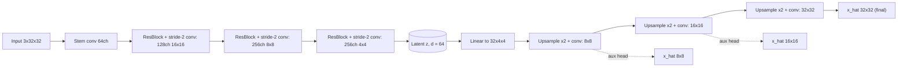
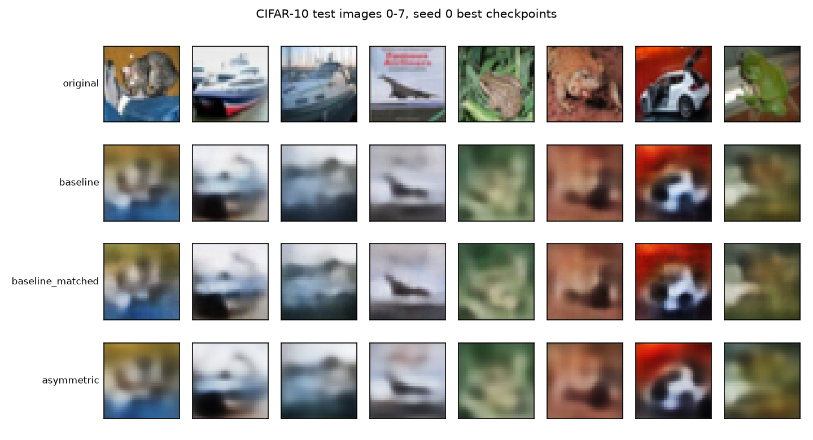
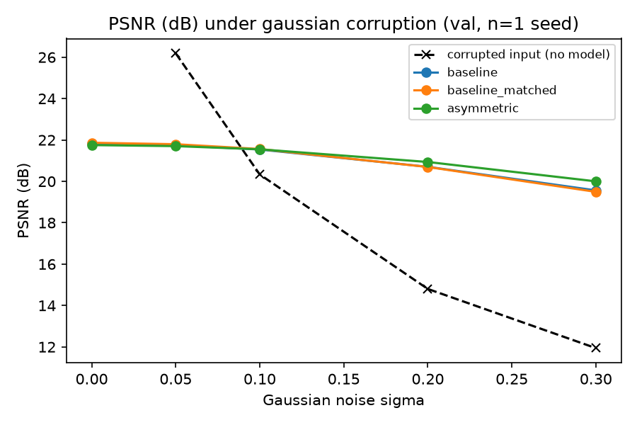
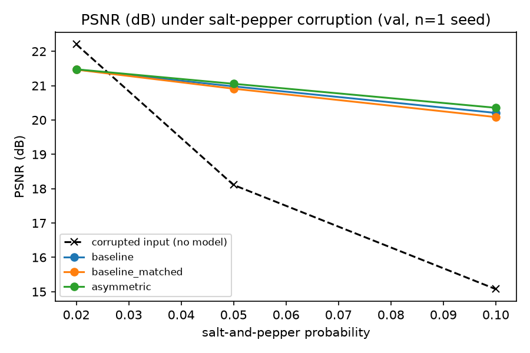
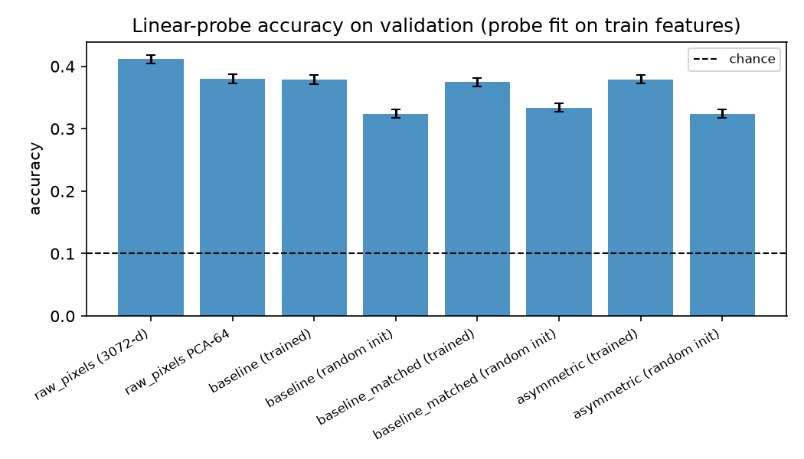
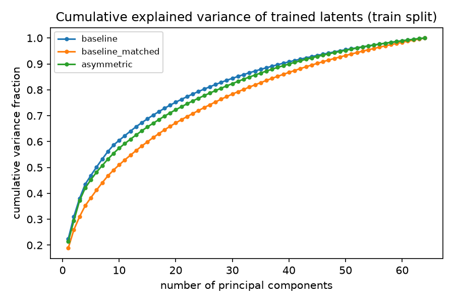
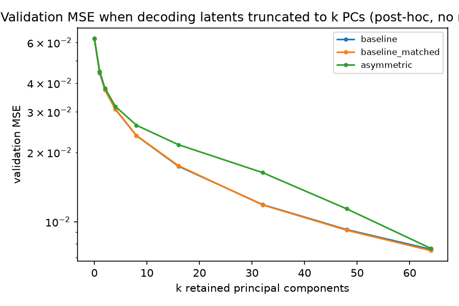
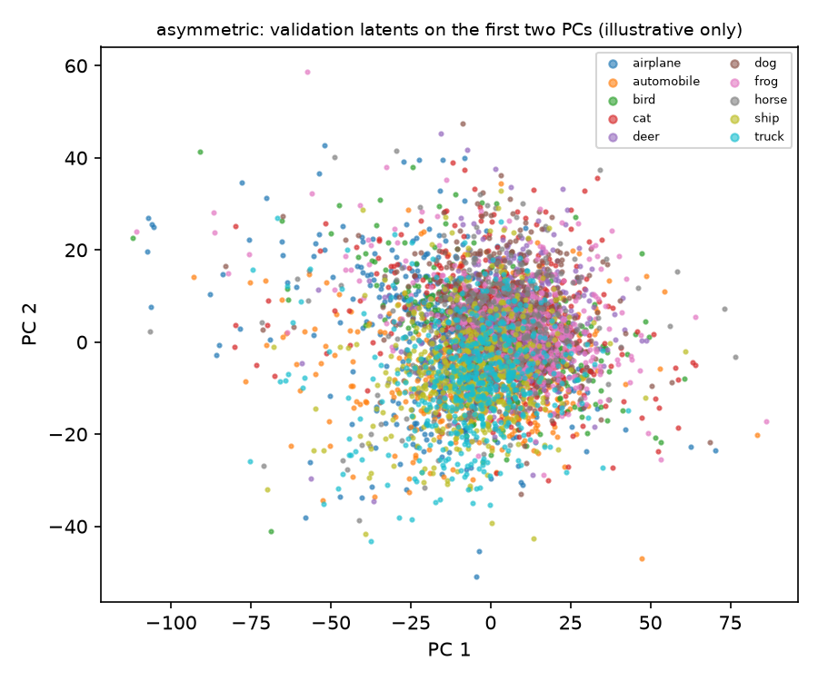

# Asymmetric Auto-Encoder Bottlenecks for Self-Supervised Latent Representation Learning

**Final report: CIFAR-10 reconstruction, efficiency, noise robustness and latent analysis**

> **Read this first.** Every number below comes from **one training run per model (seed 0)**. No
> variability across training seeds was measured, so all differences are *single-seed evidence* and
> should not be read as statistically established. The experimental plan was reduced from nine runs
> to three because of hardware limits (Section 11). The latent-dimension hypothesis (H2) was **not
> fully tested**.

## 1. Summary

We compared a conventional symmetric convolutional autoencoder (baseline), the same architecture
widened to match the asymmetric model's parameter count (matched baseline), and a proposed
asymmetric autoencoder (heavy residual encoder, 64-d bottleneck, lightweight multiscale decoder),
trained under one frozen protocol on CIFAR-10 (single seed, Apple M2).

| Question | What the evidence shows (single seed) |
|---|---|
| Reconstruction at equal latent size (H1) | The asymmetric model was **not better**: test MSE +1.1% vs the baseline and +2.3% vs the matched baseline; SSIM lower by 0.018 (-2.7%). Differences are small and not statistically assessed. |
| Cost | The asymmetric model needs **5.4x** the MACs of the matched baseline (52x the small baseline) and is 1.6-6.0x slower than the matched baseline in latency at batch 1. |
| Noise robustness (H3) | Its PSNR degrades more slowly under input noise: **directionally supported, not established**. |
| Compactness (H2) | **Not fully tested** (no latent-dimension sweep). A post-hoc proxy points the other way. |
| Latent usefulness (H4) and collapse (H5) | **No asymmetric-model advantage.** Linear-probe accuracy is the same for all trained latents; no model collapsed. |

## 2. Problem Statement and Motivation

A symmetric autoencoder can reconstruct well while learning a latent code of little use, because a
high-capacity decoder can compensate for an uninformative code, so reconstruction loss alone is a
weak measure of representation quality. We study whether an asymmetric design (an encoder that
extracts structure, a tight bottleneck, and a deliberately small decoder) yields a more compact,
useful and noise-robust latent representation than a symmetric autoencoder under comparable
training. This was posed as a **research hypothesis, not an established result**; the experiments
were designed so it could fail.

**Main research question.** Can an asymmetric autoencoder with a constrained nonlinear encoder and
lightweight multiscale decoder learn more compact, useful and noise-robust latent representations
than a conventional symmetric autoencoder under comparable training conditions?

**Hypotheses** (defined before any experiment, in the approved Phase 0 blueprint):

| ID | Hypothesis |
|---|---|
| H1 | At equal latent size, the asymmetric model reconstructs no worse than the baseline (within tolerance). |
| H2 | At equal reconstruction quality, the asymmetric model needs a smaller latent dimension. |
| H3 | The asymmetric model degrades more slowly under input noise. |
| H4 | The asymmetric latents give better linear-probe accuracy (labels used for evaluation only). |
| H5 | The asymmetric model avoids latent collapse (higher effective rank). |

## 3. Objectives

1. Build a reproducible, fair comparison harness (fixed splits, shared trainer, same evaluation code).
2. Implement and test the baseline, a parameter-matched baseline and the asymmetric model.
3. Compare reconstruction quality and computational cost.
4. Evaluate robustness to corrupted inputs and analyse the latent space with measurable diagnostics.
5. Report negative and inconclusive outcomes and every limitation honestly.

## 4. Methodology

**Data.** CIFAR-10 (50,000 training and 10,000 test images, 3x32x32), downloaded through
torchvision. Pixels are scaled to [0, 1] with no mean/std normalisation, so the sigmoid decoder
output, the target and the metric data range (1.0) agree. The training set is split deterministically
into **45,000 train / 5,000 validation** images (`split_seed` 0, independent of the training seed),
verified to be disjoint and duplicate-free across train, validation and test. Training is
self-supervised (the input is the target); labels are used only to fit and score linear probes.

**Metrics** (all on [0, 1] images; PSNR and SSIM use data range 1.0).
MSE and MAE: mean per-pixel squared and absolute error. PSNR: `10 log10(1 / MSE)` per image,
averaged over images. SSIM: 11x11 Gaussian window (sigma 1.5), checked against scikit-image to within
5e-3 in a unit test. These measure reconstruction fidelity; **none measures semantic quality**.

**Protocol (identical for every model; frozen before the experiments, commit `c670b16`).**
Adam, learning rate 1e-3, cosine annealing to 0 over 30 epochs, batch size 128, no early stopping,
latent dimension 64, seed 0. The best checkpoint is chosen by validation MSE (final-resolution MSE
against the clean input, the only loss comparable across models). Training ran on Apple MPS.

**Evaluation discipline.** The official test split was evaluated **once**, after all training and
validation analysis were complete, using the best-validation checkpoints; nothing was selected or
tuned on test results (checkpoint hashes verified unchanged). Noise robustness and all latent
analyses use the **validation** split only.

## 5. Model Architectures

### 5.1 Baseline and matched baseline (Model A)

Three stride-2 3x3 convolutions with ReLU (32, 64, 128 channels), flatten, linear layer to the
64-d latent; a mirrored decoder (linear layer, three transposed convolutions, sigmoid); plain MSE.
The **matched baseline** uses the same design with channels (104, 208, 416), giving 2,812,227
parameters, 0.40% below the asymmetric model's 2,823,625. Parameters are matched; **compute is not**
(Section 7.2).

### 5.2 Asymmetric autoencoder (Model B)



- **Encoder:** convolution stem, then three residual blocks each followed by a stride-2 convolution
  (BatchNorm and GELU), then a linear map to the latent. It is heavy: 2,773,888 parameters.
- **Decoder:** narrow (32, 32, 16, 16 channels), bilinear upsampling plus convolution (no transposed
  convolutions), with 1x1-convolution image heads at 8x8, 16x16 and 32x32. It is light: 49,737
  parameters, versus 226,243 for the baseline decoder.
- **Multiscale loss:** `sum_s w_s * MSE(x_hat_s, area_average(x, size_s))` with default weights
  (0.25, 0.5, 1.0) from lowest to highest resolution; the targets are block averages of the input, so
  each scale's loss is mathematically consistent. Final-resolution reconstructions are evaluated
  against the full-resolution image.
- **Optional recursive refinement** (one weight-tied residual block applied k times) exists but was
  off in all reported experiments (`refine_steps` = 0). "Recursive" here would mean exactly that
  weight tying, not recurrent processing.

| Model | Encoder params | Decoder params |
|---|---|---|
| baseline | 224,384 | 226,243 |
| baseline_matched | 1,403,024 | 1,409,203 |
| asymmetric | 2,773,888 | 49,737 |

## 6. Experimental Protocol and Provenance

| Item | Value |
|---|---|
| Runs reported | 3 (seed 0 of baseline, matched baseline, asymmetric), 30 epochs each |
| Runs originally planned | 9 (3 models x seeds 0, 1, 2): see Section 11 |
| Hardware | Apple M2, 8 GB, macOS; training and measurements on MPS (CPU for CPU latencies) |
| Software | Python 3.11.14, PyTorch 2.14.1, NumPy 2.4.6 |
| Frozen protocol commit | `c670b16`. The model, training, data and configuration code and the three configs are unchanged since the freeze; later commits added evaluation and analysis code only. |
| Merge points on `develop` | Phase 5 `cbcf291`, Phase 6 `2c66a66`, Phase 7 `7854771` |
| Provenance | All three runs trained on the same Mac/MPS device. The matched baseline was interrupted after epoch 28 and resumed from its checkpoint on the same device. |

## 7. Results (single seed)

### 7.1 Reconstruction quality

| Model | Params | Split | MSE | MAE | PSNR (dB) | SSIM |
|---|---|---|---|---|---|---|
| baseline | 450,627 | val (5,000 img) | 0.007586 | 0.0614 | 21.81 | 0.6491 |
| baseline | 450,627 | test (10,000 img) | 0.007601 | 0.0615 | 21.81 | 0.6496 |
| baseline_matched | 2,812,227 | val (5,000 img) | 0.007486 | 0.0610 | 21.86 | 0.6499 |
| baseline_matched | 2,812,227 | test (10,000 img) | 0.007510 | 0.0612 | 21.87 | 0.6503 |
| asymmetric | 2,823,625 | val (5,000 img) | 0.007660 | 0.0619 | 21.75 | 0.6312 |
| asymmetric | 2,823,625 | test (10,000 img) | 0.007683 | 0.0621 | 21.76 | 0.6318 |

On the test set the models are within a few percent of each other. Ordering by MSE: matched
baseline (0.007510) < baseline (0.007601) < asymmetric (0.007683). The asymmetric model is
+1.07% (vs baseline) and +2.30% (vs matched baseline) in MSE,
and its SSIM is lower by 0.0178 (-2.74%). The matched baseline, with 6.2x more
parameters, improves on the small baseline's MSE by only 1.2%. Test and validation MSE agree to
1.6e-05-2.4e-05, so checkpoint selection on validation did not overfit it.

**These differences are about 1-2% in MSE with one seed and cannot be called real.** As a caution
only: in a short pilot (2 epochs of 60 batches, not converged), two seeds of the same baseline
differed by 4.9% in validation MSE (0.02327 vs 0.02213), so seed noise of a comparable size is plausible
at convergence but was not measured. All models produce visibly blurry reconstructions.


*Figure 1. Validation MSE per epoch (log scale), seed 0. The asymmetric curve is noisier early (for
example a spike at epoch 16) and was still improving at epoch 30 (its best epoch). The matched
baseline peaked at epoch 14.*



*Figure 2. Original images (top) and reconstructions from the three best-validation checkpoints.*

### 7.2 Computational efficiency

| Model | Params | FP32 size (MB) | MACs/img | FLOPs/img | CPU b=1 (ms) | CPU b=128 (ms) | MPS b=1 (ms) | MPS b=128 (ms) | s/epoch | Train time | Best epoch |
|---|---|---|---|---|---|---|---|---|---|---|---|
| baseline | 450,627 | 1.72 | 5.4 M | 10.8 M | 0.21 | 30.1 | 0.82 | 3.9 | 11.9 | 5.9 min | 30 |
| baseline_matched | 2,812,227 | 10.73 | 52.1 M | 104.3 M | 0.51 | 144.1 | 1.74 | 30.4 | 39.5 | 19.8 min | 14 |
| asymmetric | 2,823,625 | 10.77 | 279.9 M | 559.9 M | 3.06 | 398.0 | 2.80 | 53.0 | 63.0 | 31.5 min | 30 |

FLOPs are counted with `torch.utils.flop_counter` (convolutions and matrix multiplications only; a
multiply-add is 2 FLOPs); latency is the median of 50 timed forward passes after 10 warm-up passes
(20 for CPU at batch 128), model in `eval()`, 4 CPU threads, on one machine. Training seconds per
epoch include validation and are indicative only (thermal throttling and cooldown pauses occurred).
Latencies are specific to this hardware and software.

The asymmetric model has the same size as the matched baseline but needs 5.4x its
MACs and 52x the small baseline's, and is 3.4-14.3x slower than the baseline
(and 1.6-6.0x slower than the matched baseline) depending on device and batch size.
Parameter count is therefore a poor proxy for cost here. Given reconstruction roughly equal to the
baselines, the asymmetric design pays a large compute cost without a measured reconstruction gain.

### 7.3 Noise robustness (protocol N1)

Models trained on clean images receive corrupted inputs at evaluation and are scored against the
**clean** target (PSNR dB / SSIM, validation split, 5,000 images, one noise seed; identical corrupted
images for all models). Corruption: additive Gaussian noise clipped to [0, 1]; salt-and-pepper
noise sets a fraction p of pixel positions (all channels) to 0 or 1. The "corrupted input" column
is the score of the noisy image itself, i.e. a model that changes nothing.

| Gaussian σ | Corrupted input | baseline | baseline_matched | asymmetric |
|---|---|---|---|---|
| 0.0 | identical to clean | 21.81 / 0.649 | 21.86 / 0.650 | 21.75 / 0.631 |
| 0.05 | 26.19 / 0.847 | 21.75 / 0.646 | 21.79 / 0.646 | 21.70 / 0.629 |
| 0.1 | 20.33 / 0.655 | 21.54 / 0.636 | 21.56 / 0.636 | 21.55 / 0.623 |
| 0.2 | 14.80 / 0.402 | 20.70 / 0.601 | 20.69 / 0.600 | 20.94 / 0.599 |
| 0.3 | 11.94 / 0.268 | 19.56 / 0.552 | 19.49 / 0.550 | 20.00 / 0.564 |

| Salt-and-pepper p | Corrupted input | baseline | baseline_matched | asymmetric |
|---|---|---|---|---|
| 0.02 | 22.20 / 0.817 | 21.47 / 0.631 | 21.47 / 0.629 | 21.48 / 0.617 |
| 0.05 | 18.11 / 0.639 | 20.98 / 0.606 | 20.91 / 0.602 | 21.05 / 0.597 |
| 0.1 | 15.07 / 0.467 | 20.21 / 0.567 | 20.09 / 0.562 | 20.36 / 0.565 |

| Model | Clean PSNR | PSNR drop at σ=0.3 | PSNR drop at p=0.1 |
|---|---|---|---|
| baseline | 21.81 | 2.25 dB | 1.60 dB |
| baseline_matched | 21.86 | 2.37 dB | 1.78 dB |
| asymmetric | 21.75 | 1.75 dB | 1.40 dB |



*Figure 3. PSNR versus Gaussian noise level against the clean target (validation, one seed). The dashed
line is the corrupted input itself; the uncorrupted point is omitted.*



*Figure 4. PSNR versus salt-and-pepper probability (validation, one seed).*

All three models score far above the noisy input once noise is moderate (for example about
19.5-20.0 dB against 11.94 dB at sigma = 0.3): a 64-dimensional bottleneck yields blurry reconstructions that
remove noise structurally, so this is not specific to the asymmetric design. The asymmetric model's
PSNR drops less (1.75 dB at sigma = 0.3, versus 2.25 and 2.37 dB) and is higher from sigma = 0.2, by about
0.4-0.5 dB at sigma = 0.3. Only one noise sample was drawn per level and training-seed variance is unmeasured. Two caveats limit interpretation: the asymmetric model starts lower on
clean images (PSNR 21.75 vs 21.81-21.86 dB, SSIM 0.631 vs 0.649-0.650), and a model that discards more
detail has less to lose, so a smaller drop is not by itself better denoising; and none of the models was
trained to denoise (protocol N2 was not run). For Gaussian noise, SSIM favours the baselines up to sigma = 0.2 and the ordering
reverses only at sigma = 0.3. For salt-and-pepper noise the baselines have higher SSIM at p = 0.02 and
0.05, and at p = 0.1 the asymmetric value (0.565) lies between the baseline (0.567) and the matched
baseline (0.562).

### 7.4 Latent representation analysis

Inference only (no model training), single seed, 64-d latents. PCA bases, standardisation and probes
are fitted on the 45,000 **train** images and scored on the 5,000 **validation** images. The probe is
multinomial logistic regression on frozen, standardised features, with L2 chosen on a held-out slice
of the train features. Controls: raw pixels, raw pixels reduced to PCA-64, and the same architectures
with random initialisation.

**Linear probe (chance 10%).**

| Representation | Features | Val accuracy ± s.e. | Train accuracy |
|---|---|---|---|
| raw_pixels (3072-d) | 3072 | 41.2% ± 0.7 | 45.9% |
| raw_pixels PCA-64 | 64 | 38.0% ± 0.7 | 39.2% |
| baseline (trained) | 64 | 37.9% ± 0.7 | 38.1% |
| baseline (random init) | 64 | 32.4% ± 0.7 | 33.8% |
| baseline_matched (trained) | 64 | 37.5% ± 0.7 | 38.4% |
| baseline_matched (random init) | 64 | 33.4% ± 0.7 | 34.6% |
| asymmetric (trained) | 64 | 37.9% ± 0.7 | 38.3% |
| asymmetric (random init) | 64 | 32.4% ± 0.7 | 33.4% |



*Figure 5. Validation accuracy of linear probes on frozen features (error bars: binomial standard error).*

All three trained latents give the same accuracy within error (37.5-37.9%). Training improves on
random-initialisation encoders by about 4 to 5.5 points, but no trained latent beats a plain PCA-64 of the
pixels (38.0%), and the full 3072-d pixels reach 41.2%. The probe is linear and mildly underfits
(train accuracy close to validation accuracy), and probe accuracy is only one proxy for representation
quality.

**Latent usage and collapse diagnostics (train split).**

| Model | Effective rank | Participation ratio | Dims for 90/95/99% variance | Low-variance dims | Random-init effective rank |
|---|---|---|---|---|---|
| baseline | 29.3 | 13.5 | 39/49/61 | 0 | 20.2 |
| baseline_matched | 37.2 | 18.4 | 45/54/62 | 0 | 16.0 |
| asymmetric | 31.3 | 14.5 | 41/50/61 | 0 | 14.9 |

No model has low-variance dimensions; the effective rank is about 29-37 of 64 dimensions; training
raises the effective rank above that of random initialisation for all three. The asymmetric model's
effective rank is slightly above the baseline's and below the matched baseline's.



*Figure 6. Cumulative variance explained by the first k principal components of each trained latent.*

**Post-hoc truncation (validation MSE).** Each validation latent is projected onto the first k principal
components (ordered by training-latent variance), reconstructed, and decoded by the *unchanged, trained*
decoder. This probes how much of the latent a trained decoder uses. It is **not** equivalent to
training a model with a smaller latent dimension.

| Model | k=0 | k=4 | k=8 | k=16 | k=32 | k=48 | k=64 |
|---|---|---|---|---|---|---|---|
| baseline | 0.06254 | 0.03076 | 0.02364 | 0.01741 | 0.01186 | 0.00924 | 0.00759 |
| baseline_matched | 0.06246 | 0.03086 | 0.02369 | 0.01751 | 0.01183 | 0.00918 | 0.00749 |
| asymmetric | 0.06246 | 0.03168 | 0.02624 | 0.02160 | 0.01634 | 0.01137 | 0.00766 |



*Figure 7. Validation MSE versus the number of retained latent principal components (log scale).*

The asymmetric decoder loses more than both baselines at every k from 4 to 48 in the table (11% higher MSE at k = 8,
24% at k = 16, 38% at k = 32, relative to the baseline), i.e. its information is spread over more directions,
the opposite of what a compactness advantage would predict. Because this is post-hoc, it is only a proxy for H2.



*Figure 8. Validation latents of the asymmetric model on the first two principal components, coloured by
class (illustrative only). No class structure is visible; the baseline and matched-baseline
plots are in `reports/figures/`. Such plots cannot establish semantic organisation.*

Methodological checks (against independent SVD-based re-computations): the pixel PCA-64 control was
fitted on train pixels only and applied to validation with the train mean and basis; the
truncation curve matches an independent computation to 1e-9, and the decoder receives the truncated
latent.

## 8. Assessment of the Hypotheses

| ID | Verdict | Evidence (single seed) |
|---|---|---|
| **H1** Reconstruction no worse at equal latent size | **Not supported by this evidence; not statistically rejected** | Asymmetric test MSE +1.1% vs baseline and +2.3% vs matched baseline; SSIM 0.018 lower. No variance estimate, so "within tolerance" cannot be judged. |
| **H2** Smaller latent at equal quality | **Not fully tested** | No latent-dimension sweep was run for any model. A post-hoc truncation proxy shows the asymmetric decoder depends on more latent directions (opposite to the prediction); this is not a substitute for training at other sizes. |
| **H3** Slower degradation under noise | **Directionally supported, not established** | Smaller PSNR drop (1.75 vs 2.25/2.37 dB at sigma = 0.3; 1.40 vs 1.60/1.78 dB at p = 0.1). One training seed; starts lower on clean inputs; no model was trained to denoise. |
| **H4** Better linear-probe accuracy | **Not supported** | 37.9% asymmetric vs 37.9% (baseline) and 37.5% (matched): no difference within error; equal to a PCA-64 of the pixels (38.0%). |
| **H5** Avoids latent collapse | **No evidence of an asymmetric advantage; no collapse in any model** | Effective rank 31.3 vs 29.3 and 37.2; zero low-variance dimensions for all. |

Answer to the main question on this evidence: we found **no evidence** that the asymmetric design
produced a more compact latent (H2 was not fully tested, and the post-hoc proxy was unfavourable), a
more useful latent (H4) or better reconstruction, and it cost several times more compute; a modest,
directional robustness advantage (H3) is the only possibly favourable signal, and it is not established.

## 9. Discussion

The bottleneck, not capacity, appears to dominate reconstruction at d = 64: a 6.2x larger baseline
improves MSE by only 1.2%, and the asymmetric model's extra encoder capacity and multiscale decoder
did not change that. This is an interpretation of one set of runs, not a tested conclusion. The
asymmetric model has slightly lower SSIM and is slightly more noise-tolerant; one possible reading
(not directly measured) is that its weaker decoder produces somewhat smoother, more stable output. Linear
separability of the class in all learned latents is close to that of plain pixel PCA; one possible
reading is that autoencoders trained only on pixel reconstruction learn mostly low-frequency pixel
structure, which was not tested.
The asymmetric model was still improving at epoch 30, so it may be under-trained relative to the
baselines; longer training was not tested.

## 10. Limitations

1. **Single seed.** One training run per model; no means, standard deviations or significance tests.
   Differences of about 1-2% in MSE, 0.4-0.5 dB in noisy PSNR or 1.5 probe points are not interpretable.
2. **Reduced plan.** Three of nine planned runs; latent-dimension sweep, component ablations and
   denoising training (N2) were not run.
3. **Hardware-specific measurements.** Apple M2/MPS only; training times include thermal and cooldown
   effects; latency and FLOP counts depend on the measurement method (convolutions and matrix products only).
4. **Single dataset and resolution** (CIFAR-10, 32x32) and one latent dimension (64).
5. **Proxy measures.** Reconstruction metrics, effective rank, a linear probe and post-hoc
   truncation do not establish general semantic quality.
6. **Parameter-matched, not compute-matched, baseline.** The matched baseline is far cheaper in compute
   than the asymmetric model; a FLOP-matched baseline was not trained.
7. **Possible under-training** of the asymmetric model at 30 epochs.
8. **No CUDA execution** was validated; results are MPS-only. MPS and CPU results differ slightly
   (about 0.7% in validation MSE after two short epochs, measured in a pilot).
9. No continuous integration; GitHub pull requests were not used (branches were merged locally).

## 11. Deviations from the Original Plan

- Nine runs (three seeds per model) were planned and executed on Google Colab, but those artifacts were
  lost to a runtime reset and the free GPU quota was exhausted. Because of Mac overheating, the work was
  limited to seed 0 of each model, with no further training. **No Colab-trained result is used anywhere in
  this report.**
- The latent-dimension sweep (H2), component ablations and denoising training were not run.
- t-SNE/UMAP were not produced (illustrative only).
- The matched baseline was resumed once from its epoch-28 checkpoint on the same device.

## 12. Reproducibility

Everything is in the public repository (`aman-18-choudhary/Asymmetric_Auto_Encoder`, branch `develop`).

```bash
git clone https://github.com/aman-18-choudhary/Asymmetric_Auto_Encoder.git
cd Asymmetric_Auto_Encoder
python3.11 -m venv .venv && source .venv/bin/activate
pip install -e ".[dev]"
python scripts/download_data.py --name cifar10                      # about 163 MB
pytest && ruff check .                                              # 121 tests

# training: one run per model, seed 0, about 6 / 20 / 32 minutes on an M2 (MPS)
python scripts/train.py --config configs/baseline.yaml --seed 0
python scripts/train.py --config configs/baseline_matched.yaml --seed 0
python scripts/train.py --config configs/asymmetric.yaml --seed 0

R=experiments/results
python scripts/evaluate.py $R/*_cifar10_seed0 --split val --efficiency
python scripts/robustness.py $R/*_cifar10_seed0 && python scripts/robustness_report.py
python scripts/latent_analysis.py                                    # inference only, about 2 minutes
# Final test evaluation: a one-time step, to be run only after everything above is frozen
python scripts/evaluate.py $R/*_cifar10_seed0 --split test --allow-test
python scripts/aggregate.py --seeds 0 --split test
```

Notes. **Re-running overwrites committed results.** The seed-0 result files (configurations, histories,
summaries, evaluation JSON, logs; not checkpoints) are tracked in Git, so retraining with the commands
above overwrites them in place and appends to `train.log`, and re-runs are not bit-identical to the
committed numbers. Back up `experiments/results/` first, or write to a separate directory: train with
`--run-dir <dir>/<model>_cifar10_seed0`, pass those run directories to `evaluate.py` and
`robustness.py`, and pass `--results-dir <dir>` (plus `--fig-dir <figdir>` so `reports/figures/` is not
overwritten) to `aggregate.py`, `robustness_report.py` and `latent_analysis.py`.
Configuration, history, summaries and evaluation JSON for every run are in
`experiments/results/<model>_cifar10_seed0/`; model checkpoints are git-ignored. Splits are
deterministic; seeds are fixed. Exact bit-for-bit reproducibility holds on the same device (resume from
a checkpoint was tested to reproduce an uninterrupted run exactly on CPU and once on MPS); MPS and
CPU results differ slightly, and MPS/CUDA kernels are not guaranteed deterministic. Each run
directory stores `environment.json` with library versions. The stored `efficiency.json` files were produced with the same
functions as `evaluate.py --efficiency` and additionally contain a repeat measurement in reversed model order. The per-phase reports in
`docs/phase_reports/` record decisions, commands and verification for every stage.

## 13. Future Work

1. Run at least three training seeds per model and report means and standard deviations; only then
   judge H1 and H3.
2. Run the latent-dimension sweep (for example d in {8, 16, 32, 64, 128}) for both architectures, with a
   parameter-matched baseline, to test H2 properly.
3. Train a FLOP-matched baseline and longer schedules for the asymmetric model.
4. Add denoising training (protocol N2) and component ablations (single-scale loss, refinement steps,
   decoder width, multiscale weights).
5. Evaluate richer representation probes (non-linear classifiers, k-nearest neighbours) and other
   datasets or resolutions.
6. Validate on CUDA and add continuous integration.

## Appendix A. Artifact Map

| Artifact | Location |
|---|---|
| Phase reports (decisions, commands, verification) | `docs/phase_reports/phase_00` ... `phase_07` |
| Frozen configs | `configs/baseline.yaml`, `configs/baseline_matched.yaml`, `configs/asymmetric.yaml` |
| Run results | `experiments/results/<model>_cifar10_seed0/` |
| Aggregated tables | `experiments/results/core_comparison_{val,test}.md`, `robustness_val.md`, `latent_analysis_val.md` |
| Figures | `reports/figures/` |
| Cloud-transfer notes (historical) | `docs/cloud_training.md` |
